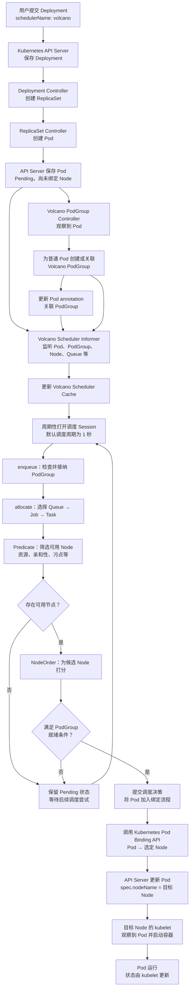

# Volcano Pod 创建与调度流程

本文以普通 Kubernetes Deployment 为例，说明一个指定 `schedulerName: volcano` 的 Pod 如何被创建、调度并运行。

## 示例 Deployment

```yaml
apiVersion: apps/v1
kind: Deployment
metadata:
  name: nginx-demo
spec:
  replicas: 1
  selector:
    matchLabels:
      app: nginx-demo
  template:
    metadata:
      labels:
        app: nginx-demo
    spec:
      schedulerName: volcano
      containers:
        - name: nginx
          image: nginx
          resources:
            requests:
              cpu: "500m"
              memory: "512Mi"
```

## 流程图



## 分步骤解释

### 1. Kubernetes 创建 Pod

用户提交 Deployment 后，Deployment Controller 创建 ReplicaSet，ReplicaSet Controller 再创建 Pod。Pod 从模板继承 `schedulerName: volcano`，创建后暂时处于 Pending 状态，尚未绑定节点。

### 2. Volcano 准备调度上下文

Volcano PodGroup Controller 观察到 Pod 后，可以为普通工作负载创建或关联 Volcano PodGroup，并通过 Pod annotation 记录关联关系。

与此同时，Volcano Scheduler 使用 Informer 监听 Pod、PodGroup、Node、Queue 等资源，并维护本地缓存。Controller 和 Informer 异步处理事件；流程图中的箭头表示依赖关系，并非严格的事件到达顺序。

相关代码：[PodGroup Controller](../pkg/controllers/podgroup/pg_controller.go#L147)、[PodGroup annotation](../pkg/controllers/podgroup/pg_controller_handler.go#L183)、[Scheduler Informer](../pkg/scheduler/cache/cache.go#L685)。

### 3. Volcano Scheduler 选择节点

Scheduler 周期性地基于缓存快照打开调度 session。本仓库的内置默认配置依次执行 `enqueue`、`allocate` 和 `backfill`；实际部署可以修改 action 和插件配置。默认调度周期为 1 秒。

在 `allocate` 阶段，Scheduler 选择 Queue、Job 和 Task，筛选并评分节点。满足 PodGroup 就绪条件后，Scheduler 提交暂定分配；否则放弃暂定分配并等待后续调度尝试。具体重试时机受配置影响，例如可选的不可调度作业缓存可能暂时跳过该作业。

这里的 **Job 是 Volcano Scheduler 内部的调度表示**；本示例没有创建 Volcano Job CRD。

相关代码：[调度循环](../pkg/scheduler/scheduler.go#L108)、[默认 action 配置](../pkg/scheduler/util.go#L38)、[allocate 流程](../pkg/scheduler/actions/allocate/allocate.go#L138)。

### 4. 绑定并运行

Volcano 选择节点后，通过 Kubernetes Pod Binding API 提交绑定。API Server 将 Pod 绑定到目标 Node；随后该节点的 kubelet 观察到 Pod，创建并运行容器。

Volcano Scheduler 负责选择节点和提交绑定；启动容器由 kubelet 负责。相关代码：[Binding 实现](../pkg/scheduler/cache/cache.go#L244)。

> 本示例只有一个副本，主要展示接入流程。如果需要多个 Pod 按 gang 语义一起调度，还需要配置相应的 PodGroup 和最小成员数；只设置 `schedulerName: volcano` 并不足以表达该要求。
